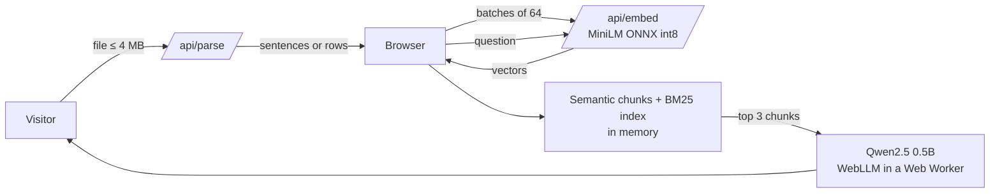

# SoldrinAI RAG Chatbot

Upload a document and chat with it. Retrieval runs on a small serverless API; the language model runs **privately in the visitor's browser**, so there is no GPU bill and no chat history on a server.

| | |
|---|---|
| **Files** | PDF, Word (.docx), TXT, Markdown, Excel (.xlsx), CSV |
| **Chunking** | Prose is split into sentences and grouped by meaning (semantic chunking). Tables use **one row per chunk**. |
| **Retrieval** | Hybrid: **65% semantic** (MiniLM cosine) + **35% BM25 keyword** |
| **Answers** | `Qwen2.5-0.5B-Instruct` (4-bit) running in the browser via WebLLM / WebGPU |
| **Privacy** | Nothing is stored. Text is sent to the API only to compute embeddings; answers are generated on-device. |

## How it works



1. **Parse** (`/api/parse`): the file is read server-side and split into units (sentences, or table rows).
2. **Embed** (`/api/embed`): `all-MiniLM-L6-v2`, quantized to int8 ONNX (~23 MB) and bundled in the repo, produces 384-d vectors.
3. **Chunk** (browser): neighbouring sentences are merged until similarity to the running chunk drops (topic change) or the chunk reaches 550 characters. Chunk vectors are the mean of their sentence vectors.
4. **Retrieve** (browser): hybrid score of cosine similarity and BM25, top 3 chunks.
5. **Answer** (browser): the model sees only those chunks (500 characters each) plus the last two turns, and cites them as `[1]`, `[2]`.

## The model download

The visitor is told before anything downloads: about **300 MB, once, nothing to install**. Weights are cached by the browser (Cache API) and reused on later visits. The UI offers:

- **Delete model data now**: removes the cached weights immediately.
- **Remove the model when I close this tab**: best effort. Browsers cannot finish async work while a page unloads, so the choice is remembered and the weights are deleted at the start of the next visit.

Requires a WebGPU browser (desktop Chrome or Edge, recent Safari). Unsupported browsers get a clear message.

## Limits (so nobody can upload huge amounts of data)

| Limit | Value |
|---|---|
| Upload size | 4 MB (also Vercel's request cap), checked in the browser and the API |
| Prose | first 150,000 characters, 60 PDF pages, 1,200 sentences; sentences capped at 400 characters |
| Tables | first 500 rows and 40 columns; each row capped at 600 characters |
| Embedding calls | 128 texts per request, 1,000 characters each |

Anything beyond a limit is ignored and the UI says so ("only the first … were used"). Edit the constants at the top of [`backend/files.py`](backend/files.py) to change them.

## Project layout

```
backend/                 FastAPI on Vercel serverless (Python)
  index.py               /api/parse, /api/embed, /api/limits, /api/health
  files.py               file parsing and all size caps
  engine.py              ONNX Runtime embeddings
  model/                 bundled MiniLM int8 model + tokenizer
  tests/
frontend/                Vite + React + TypeScript
  src/lib/chunking.ts    semantic chunking, row chunks
  src/lib/search.ts      BM25 + cosine hybrid ranking
  src/lib/llm*.ts        WebLLM engine (lazy loaded), prompt, cache control
  src/llm.worker.ts      runs the model off the main thread
vercel.json              frontend + backend services, /api routing
```

## Run locally

```bash
# API (Python 3.10+)
cd backend && python -m venv .venv && .venv/bin/pip install -r requirements.txt
.venv/bin/uvicorn index:app --port 8000

# Web (new terminal)
cd frontend && npm install && npm run dev      # http://localhost:5173, /api proxied to :8000
```

Tests: `cd backend && python -m pytest tests -q` and `cd frontend && npm test`.

## Deploy to Vercel

1. Import this GitHub repo at [vercel.com/new](https://vercel.com/new).
2. Keep the detected settings. [`vercel.json`](vercel.json) declares the `frontend/` and `backend/` services and routes `/api/*` to the backend.
3. Deploy. No environment variables are needed.

## Notes

- The first request after idle can be slow while the serverless function loads the embedder.
- There is no per-IP rate limiting on the free tier; add one (for example Upstash) before heavy public traffic.
- Small models are good at grounded Q&A over short excerpts and weak at long reasoning or summaries of whole documents.
